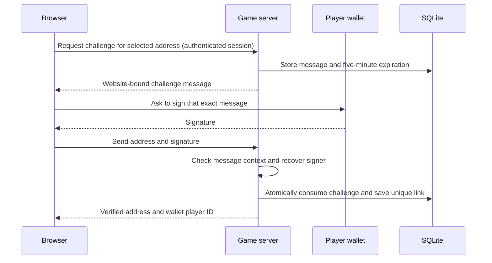

# Lesson 1: proving wallet ownership

This lesson implements the first part of Sam's Web3 plan: link an existing game profile to a wallet and expose a stable wallet account ID. It uses message signing and local database storage. No deployment, funds or blockchain transaction is required for this step.

## What the player does

Open http://localhost:5173, enter the game, then open **Your legacy** and choose **Link your wallet**. Select a wallet account and read the signing request. It names the website, the game profile, Base Sepolia (chain ID 84532), and the expiration time. Approve the message signature to finish linking. A wallet may ask you to select Base Sepolia to match the message's network.

The screen shows the verified address and a wallet player ID after success. Requesting a signature again verifies the same link with a fresh challenge. A wallet already linked to a different profile produces a conflict; it does not move that link. Wallet replacement and lost guest-account recovery require separate flows and are not implemented here.

This implementation supports ordinary externally owned Ethereum accounts through an injected browser wallet (`window.ethereum`). Smart-contract wallet signatures need additional chain-aware verification. The automated tests use disposable accounts to exercise the real signature mathematics without requiring a browser extension.

## The difference between the three IDs

| ID | Example | Purpose |
| --- | --- | --- |
| Game profile ID | A UUID generated when a session is created | Tracks your name, progress, results and inventory in the game |
| Wallet address | `0x…` followed by 40 hexadecimal characters | Identifies a blockchain account |
| Wallet player ID | `eip155:84532:0x…` | Identifies that wallet account in the context of Base Sepolia |

The wallet ID follows the CAIP-10 account-ID form. `eip155` is the chain namespace, `84532` is the network number, and the last part is the address. We normalize addresses to lowercase for storage and deduplication. A wallet ID can be constructed before an account has made any transaction. Its presence does not mean a profile was registered on-chain.

## Walk through the flow



**Challenge:** The server asks the player to sign a specific message. We use the Sign-In with Ethereum (SIWE) message format, which includes the website domain, wallet address, URI, chain ID, issue time, expiry, and a random nonce. Its request ID is the authenticated game profile ID. Here the format is used for wallet linking; it does not create a wallet-login session.

**Nonce:** A fresh random value means an old signature cannot satisfy a new challenge. The challenge expires after five minutes. Requesting a new challenge replaces the previous one.

**Signature:** The wallet uses the private key internally to sign. The game receives only the public address and signature. `personal_sign` is a message-signing request, rather than a transaction request. The game never asks for a recovery phrase or private key.

**Verification:** The server verifies its own stored message. If it let the browser choose the message, a signature from another situation could be misused. It also checks that the domain, chain, address and player match the intended context.

**Atomic consumption:** Two requests can both start checking the same signature before either finishes. After verification, a database transaction deletes the exact, unexpired challenge and saves the link. Only one request can delete that row. The other fails. If the link conflicts with another player, the transaction rolls back without altering the existing owner.

## Read the implementation in this order

1. `apps/web/src/main.tsx`, `WalletPanel`: requests an account, asks the server for a challenge, requests `personal_sign`, and submits the signature.
2. `apps/server/src/index.ts`, `/api/wallet/nonce` and `/api/wallet/bind`: validates requests and uses the authenticated profile, rather than trusting a player ID supplied by the browser.
3. `apps/server/src/wallet.ts`, `issueWalletChallenge`: creates and stores the SIWE message.
4. The same file, `bindWallet`: validates message context, verifies the signature, consumes the challenge, and checks unique ownership.
5. The same file, `walletIdentity`: returns the address, wallet player ID and explicit `off-chain` registration status.
6. `tests/wallet.test.ts`: exercises wrong signers, wrong addresses/profiles, expiry, replacements, concurrent reuse and ownership conflicts.

The two wallet tables previously initialized by `hosted.ts` are now initialized in the core store, so both wallet linking and match recording can use them. Existing tables and links are retained. Challenges issued under the previous message format require requesting a fresh challenge.

## Try it without a browser wallet

Run the focused tests:

```sh
npm test -- tests/wallet.test.ts tests/network.test.ts -t 'wallet|simulated gathering'
```

For a useful learning exercise, open the test that rejects a different wallet's signature. The challenge names wallet A, but wallet B signs it. The server rejects B's signature, leaves A unlinked, and then accepts A's valid signature. Next read the concurrent-attempt test: both requests carry a mathematically valid signature, yet exactly one succeeds because the nonce is single-use.

Questions you should be able to answer after reading:

- Why does typing a wallet address into a form prove nothing about who controls it?
- Why must a new attempt use a new random nonce?
- Why is checking the signature insufficient without checking the website and player?
- Why is the transaction needed after the asynchronous signature check?
- Why does showing a wallet player ID not prove on-chain registration?

## Deployment configuration

`WALLET_ORIGIN` is the public frontend origin shown in signatures, for example `https://game.example`. It defaults to the first `CORS_ORIGINS` entry, then `http://localhost:5173`. Browser wallet endpoints reject requests from a different origin. API requests without an Origin header still require the authenticated game session and valid challenge/signature.

Keep this origin consistent with the site the player opens, including scheme and port. It must be a trusted server setting rather than a value copied from the incoming request's Host header. No new API keys or npm dependencies are needed for this implementation.

## What comes next

Continue with [Lesson 2: match proofs](LESSON-02-MATCH-PROOFS.md), which snapshots the verified identity into a versioned match result and adds independent result verification. On-chain profile registration and badge minting follow as separate, visible transactions.

Primary references: [Sign-In with Ethereum, ERC-4361](https://eips.ethereum.org/EIPS/eip-4361), [CAIP-10 account IDs](https://standards.chainagnostic.org/CAIPs/caip-10).
