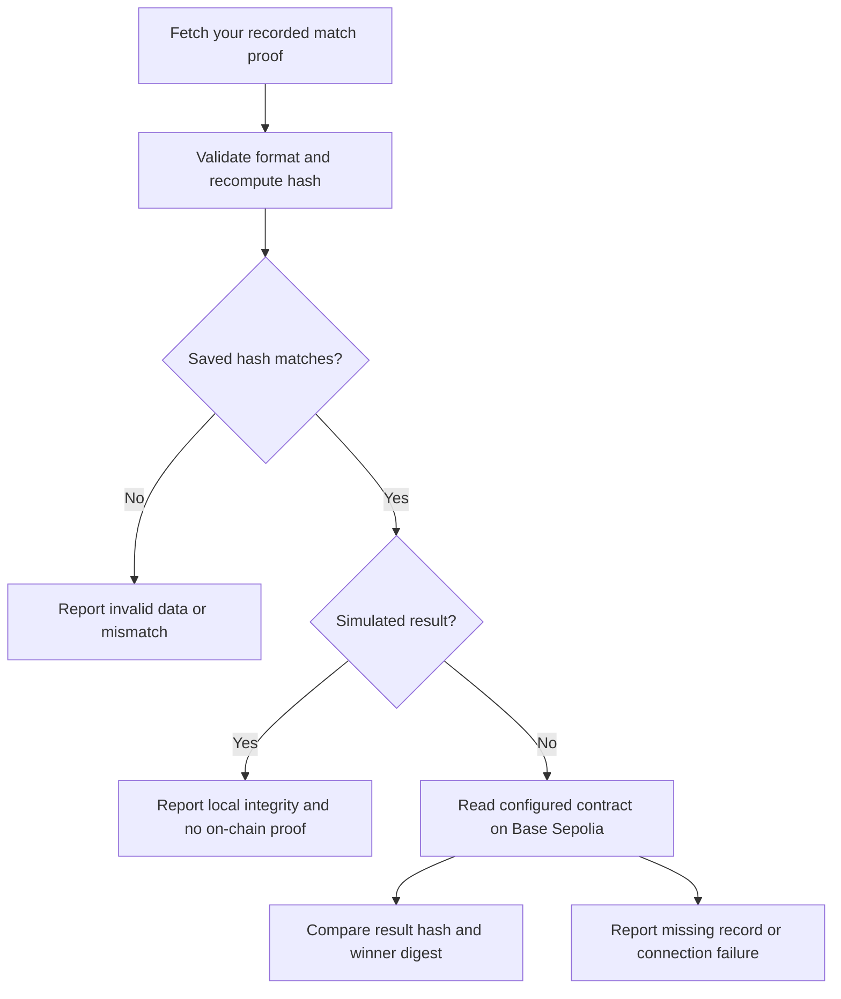

# Lesson 2: checking a completed match

The game can now save the player identities at match completion and check the result's fingerprint in the browser. When a real Base Sepolia contract is configured, the same button reads that contract and checks its result hash and winner digest. You do not need a wallet to try the simulated flow.

## Try it

1. Open http://localhost:5173 and play the story demo or complete basic training.
2. Open **Your legacy**, find **Battle chronicles**, and expand a recorded match.
3. Read its match ID, winner, score, finish time and the identities recorded at finish.
4. Choose **Verify result**.

With the default local configuration you should see **Saved result fingerprint matches** and **Simulated result. There is no on-chain proof.** That is a successful local integrity check. It is not a blockchain confirmation.

## What a hash checks

Imagine the saved result says Sam scored 570 and the opponent scored 490. The server converts the result to a consistent text representation and computes its Keccak-256 hash. A hash is a short fingerprint of those exact bytes.

The browser independently repeats that calculation. Changing 570 to 580 changes the fingerprint, so the saved fingerprint no longer matches. If somebody changes both the score and its saved fingerprint, the local check can pass. This is why we also need a separate, earlier record on the blockchain.

The verifier has two independent outputs:

| Check | What it establishes | What it does not establish |
| --- | --- | --- |
| Saved fingerprint matches | The fetched result hashes to the saved fingerprint | That the original score was honest, or that neither result nor fingerprint was replaced together |
| On-chain record matches | The freshly computed hash and winner digest match the configured contract's current record for this match | That the trusted game server judged combat fairly |

The contract address is shown for inspection. Verification is against that configured deployment; a matching record in an arbitrary contract is not proof of an official tournament. The game server remains the trusted referee, and the frontend/RPC/network remain part of the verification trust model.

## Why snapshot player identity

New results use **version 3**. Each participant includes their name and one identity snapshot:

- `wallet`: the verified wallet address, network and wallet account ID at finish;
- `profile`: the game profile, with no wallet linked at finish;
- `bot`: an AI player without a human game profile.

Linking a wallet tomorrow does not rewrite today's result. A disconnected human keeps their human/wallet identity even when an AI substitute controls their character. The existing `bot` field records AI control at finish; the identity describes who the player is.

The winner digest is the hash of a sorted JSON list of the winning participants' account IDs. Unlinked profiles use `profile:<profile-id>` and actual bots use `bot:<actor-id>`. Earlier version 1 and 2 results retain their original hashes and their old winner-ID calculation. No historical result is rewritten or silently upgraded.

## What the button does

The browser does not treat the server's `confirmed` label or a transaction link as sufficient evidence. It queries the contract through the public Base Sepolia RPC. A missing record, an unavailable network and a mismatched record produce different messages. Checking a result performs reads and does not request a wallet signature, spend funds, or send a transaction.

## Follow the code

- `packages/shared/src/results.ts`: common result format, canonical JSON, hashing, wallet IDs, winner digest, contract read ABI and validation. The original canonical-hashing behavior is preserved for older records.
- `apps/server/src/store.ts`: snapshots identities and saves the result transactionally with progression, rewards and the outbox entry. The wallet tables are initialized here so recording a result does not depend on optional hosted-auth setup.
- `apps/server/src/result-proof.ts`: fetches an immutable proof for a recorded participant. The HTTP route is `GET /api/results/:id/proof`; another player cannot fetch a private match merely by guessing its ID.
- `apps/server/src/attestation.ts`: checks integrity again before submitting, uses the version-appropriate winner IDs, and checks both hash and winners when recovering an existing anchor.
- `apps/web/src/services/proofs.ts`: recomputes the fingerprint locally, then independently reads the configured contract when appropriate.
- `apps/web/src/MatchRecord.tsx`: history details, recorded identities, verify/retry controls and human-readable outcomes. A transaction link is labeled as a transaction, without claiming receipt confirmation from the link alone.

For the testnet flow, set a real `RECORDS_ADDRESS` on the backend after deploying the contract. The existing broadcasting configuration and attestor signer are needed to write real records. Demo-mode results deliberately remain simulated. The browser uses the public Base Sepolia endpoint for its independent read rather than exposing the server's private RPC configuration or signing key.

## Tests and limits

The proof tests exercise score/identity tampering, unchanged historical snapshots, AI substitution, participant access, incompatible data, unavailable RPC, missing records, wrong winners and legacy formats. The contract test deploys RoyalRecords on a disposable local Ganache chain and runs the same verifier against the actual contract. Changing both the score and saved hash passes local integrity but fails against the old contract record.

The network tests use real signed wallet challenges and server-produced training/duel results. They check that both participants can retrieve their match proof, strangers receive 404 and unauthenticated requests receive 401.

No public-testnet transaction or browser-extension acceptance test is implied by the local tests. Profile registration and automatic badge minting are still later steps. A matching result record is an attestation from the trusted server, not a mathematical proof of fair combat.

Validation for this milestone: **77 tests passed across 11 files** (29 October 2026), including 17 dedicated proof cases, real network proof-access tests and the local Ganache contract scenario. TypeScript, lint and the final production build passed. Browser visual/extension checks and public-testnet transactions were not performed.

Primary network reference: [official Base connection details](https://docs.base.org/get-started/connect-to-base), including Base Sepolia chain ID 84532, public RPC `https://sepolia.base.org`, and explorer `https://sepolia.basescan.org`.
